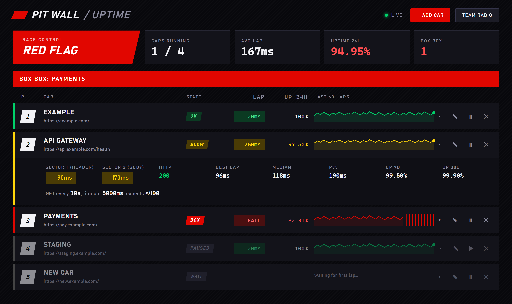

# 🏁 Pit Wall

A self-hosted uptime monitor dressed as an F1 pit-wall screen. Add URLs, watch live latency and 24h / 7d / 30d uptime, and get a Slack, Discord or webhook message when something goes **BOX BOX** and when it recovers.

- **Timing-screen colours:** each check is a "lap". Purple = personal best, green = normal, yellow = slow. Sector 1 is time to headers, sector 2 is body download.
- **Race flags:** green, yellow (slow) or red (down) for the whole grid at a glance.
- **Live:** the page updates over Server-Sent Events. No polling, no frontend build.
- **Small:** plain Node.js, SQLite, no dependencies, no `npm install`.
- **Team ready:** shared password, Docker image, one-command HTTPS deploy.

## Screenshot



Sample data: one car in BOX BOX, one slow, one paused, one waiting for its first check, and the SLOW car expanded to show sector times, median, p95 and uptime.

## Quick start (just you)

Needs **Node 22.13 or newer** (uses the built-in `node:sqlite`).

```
node server.js
```

Open http://localhost:3000, click **+ Add car**, enter a URL. Without a password it only listens on `127.0.0.1`.

## Deploy for a team

Any VPS with Docker and a domain pointing at it:

```
cp .env.example .env        # set DOMAIN and ADMIN_PASSWORD (12+ characters)
docker compose up -d --build
```

Caddy fetches a free HTTPS certificate and proxies to Pit Wall. Log in with any username and `ADMIN_PASSWORD`. Data lives in the `pitwall-data` Docker volume: back it up.

On Fly.io, Render, Railway and similar: deploy the `Dockerfile`, set `ADMIN_PASSWORD`, mount a persistent disk at `/data`, and use `/healthz` as the health check. Run **one instance only** (SQLite plus an in-process scheduler).

## Configuration

| Variable | Default | Meaning |
|---|---|---|
| `ADMIN_PASSWORD` | none | Shared password (HTTP Basic auth). Required, 12+ characters, for any non-local `HOST`. |
| `HOST` | `127.0.0.1` | Address to listen on. |
| `PORT` | `3000` | Port. |
| `DB_PATH` | `./data/pitwall.db` | SQLite file. |

Per monitor, set in the UI: name, URL, GET or HEAD, interval (10 to 3600 s), timeout (1 to 30 s) and the expected status (0 = anything below 400).

## When does BOX BOX trigger?

Checked against the last 60 samples, first match wins:

1. The last 3 probes all failed.
2. More than 20% failed (with at least 5 samples).
3. The last lap took more than 2x the median (with at least 5 samples).

Yellow flag: the last probe failed, or the last lap took more than 1.5x the median. Alerts are sent only when a monitor turns red and when it recovers, not repeatedly in between.

## Alerts

Open **Team radio** to add a channel (Slack, Discord or a generic webhook) and press **Test** to check it. Pit Wall sends a JSON `POST` when a car goes BOX BOX and again when it recovers:

| Channel | Body |
|---|---|
| Slack | `{ "text": "🔴 BOX BOX: API is degraded (HTTP 503) https://..." }` |
| Discord | `{ "content": "🔴 BOX BOX: API is degraded (HTTP 503) https://..." }` |
| Webhook | `{ "text": "...", "event": "down" \| "up" \| "test", "monitor": "API", "url": "https://...", "info": "HTTP 503" }` |

Webhook URLs are never sent back to the browser, only the host is shown.

## Project layout

```
server.js          HTTP server, auth, routing, serves public/
src/               backend modules (config, auth, db, probe, scheduler, alerts, api, ...)
public/index.html  markup only
public/styles.css  all styling, class selectors only
public/app.js      all front-end behaviour
test.js            unit checks for the health logic and URL validation
```

## Tests

```
node test.js
```

Covers the health logic and URL validation (no database or network needed).

## Limits

- One shared password, no per-user accounts.
- No email alerts: use Slack, Discord, a webhook, or a webhook-to-email service.
- No public status page or long-range charts yet.
- Alerts come from one server, so if it is down nobody is told. Point an external pinger at `/healthz`.
- Monitors can target any http(s) URL, including internal addresses. Fine for a trusted team, not for open sign-up.
- No limit on password guessing: use a long password.

## Contributing

Issues and pull requests are welcome.

- Keep it dependency-free, with no front-end build step.
- Use 2-space indentation (`.editorconfig` is included).
- In CSS, style with classes only: no tag or `#id` selectors. Reuse the shared ones (`.btn`, `.input`, `.eyebrow`, `.num`) before adding new rules.
- Run `node test.js` before sending a change.

## License

[MIT](LICENSE)
